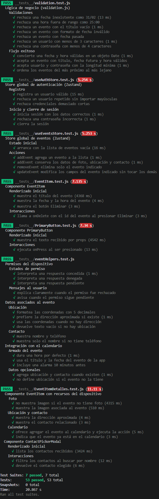

# 📅 Agenda / Recordatorios

App móvil hecha con **React Native + Expo** para la materia Aplicaciones Móviles.
Continuación del Parcial 1 (opción elegida: **Agenda / Recordatorios**).

## Cómo ejecutar la app

```bash
npm install
npx expo start
```
Escanear el QR con **Expo Go** (Android/iOS). Al crear un usuario nuevo, la app pide los permisos a medida que se usa cada recurso.

## Cómo correr los tests

```bash
npm test
```


## Funcionalidades del Parcial 1

- Registro e inicio de sesión local. Sin sesión no se accede a la app.
- Navegación con Stack: Login, Registro, Home y Alta de evento.
- Alta de eventos con título, fecha (DD/MM/AAAA) y hora (HH:MM) con validaciones.
- Lista de eventos ordenada por fecha, con opción de eliminar.
- Persistencia de datos y de la sesión al cerrar la app.
- Notificación local programada a la fecha y hora del evento (y botón de prueba a los 5 segundos).
- Componentes reutilizables: `EventItem` (tarjeta de cada evento) y `PrimaryButton`.

## Nuevas funcionalidades del Parcial 2

### 1. Permisos y acceso a recursos del dispositivo
Cada recurso pide su permiso **antes** de usarse (`src/utils/permissions.js`). Se manejan los tres estados: **concedido**, **denegado** y **pendiente**. Si el permiso es rechazado, se muestra un mensaje claro y, si Android ya no permite volver a preguntar, un botón para abrir los ajustes del teléfono.

### 2. Cámara y galería (`expo-image-picker`)
Al crear un evento se puede tomar una foto con la cámara o elegir una imagen de la galería. La imagen queda asociada al evento y se muestra en la lista.

### 3. Ubicación (`expo-location`)
Botón "Usar mi ubicación actual": obtiene las coordenadas GPS y una dirección aproximada, se guardan en el evento y se muestran en la lista.

### 4. Contactos y calendario
- **Contactos (`expo-contacts`)**: se elige un contacto de la agenda del teléfono (con buscador) y queda asociado al evento.
- **Calendario (`expo-calendar`)**: el evento se puede crear en el calendario del dispositivo al guardarlo, o después desde la lista con "Agregar al calendario". Se guarda el vínculo y la lista muestra "En el calendario".

### 5. Estado global con Zustand
Se migró el estado a dos stores (`src/store/`), persistidos en AsyncStorage:
- `useAuthStore`: usuarios registrados y usuario autenticado (acciones `register`, `login`, `logout`).
- `useEventsStore`: lista principal de eventos (acciones `addEvent`, `removeEvent`, `updateEvent`).

Las pantallas leen y modifican el estado mediante los hooks de los stores, sin `useState` para datos compartidos ni *prop drilling*. Se eliminó el antiguo `AuthContext`.

### 6. Testing con Jest + React Native Testing Library
Tests organizados con bloques `describe` descriptivos:
- Stores: agregar, eliminar y actualizar eventos; registro, login y logout.
- Componentes: `EventItem` (foto, ubicación, contacto, calendario), `PrimaryButton` y `ContactPickerModal`.
- Lógica: validaciones, estados de permiso, formato de ubicación y contacto, armado del evento de calendario.


## Video demo

https://youtube.com/shorts/kLP27aD4wK0?si=0paN0xxCO4gQ8PN7

https://www.youtube.com/shorts/lGla-dVAfJI
